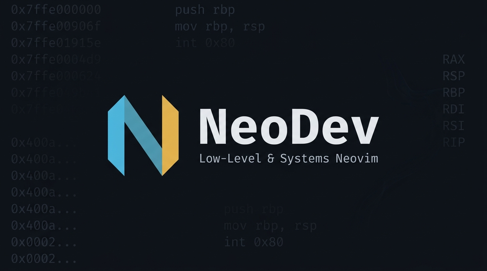

<div align="center">

# ⚡ NeoDev: Low-Level & Security Engineering Neovim Setup

**A streamlined, keyboard-driven Neovim configuration built for C, C++, Rust, and Assembly programmers.**

[](#prerequisites)
[](#theme--fonts)
[](#theme--fonts)
[](#-interactive-debugging-dap--gdb)
[](LICENSE)

</div>

---

## 🎯 Why This Setup?

Most modern IDEs are heavy, sluggish, and hide critical details behind dozens of abstract UI layers. When you work with systems programming, OS kernels, exploit analysis, or reverse engineering, you need:

1. **Raw speed**: Sub-30ms startup time and zero UI stutter.
2. **First-class language intelligence**: Fast type resolution, opcode documentation, and compiler diagnostics without opening a browser.
3. **Native debugging**: Stepping through instructions, breakpoints, memory, and registers directly in your editor using native **GDB / GEF**.
4. **Binary inspection on demand**: Toggling between raw hex byte representations and source code in a single keystroke.

This repository packages a battle-tested, modular Neovim configuration based on **NvChad** and **lazy.nvim**, customized for the low-level developer workflow.

---

## 🌟 Key Highlights

- **Ayu Dark & JetBrains Mono**: Clean, high-contrast dark palette tailored for long reading sessions of dense C code and disassembly.
- **Rust Tooling**: `rust-analyzer` configured with **Clippy on save**, procedural macro expansion, and toggleable inline **Inlay Hints** (`<leader>ih`).
- **C & C++ Tooling**: `clangd` with background indexing, `clang-tidy` analysis, and parameter placeholders.
- **Assembly Intelligence**: `asm-lsp` supporting x86_64, ARM, NASM, and GAS. Hover over any opcode with `K` to read its official instruction manual entry and flag effects.
- **In-Editor GDB / GEF Debugging**: Fully configured `nvim-dap` interface. Launch binaries, stop at entry, attach to running PIDs, and inspect scopes, watches, and call stacks.
- **Live Hex Mode**: Hit `<leader>hx` on any file to toggle a raw hex dump view (`xxd`) with byte offsets and ASCII side-by-side. Make your edits and toggle it back to raw binary.
- **Instant Scratchpad Terminals**: Floating shell (`Alt + i`) for quick CLI commands (`readelf`, `checksec`, `objdump`, `r2`) without breaking your buffer layout.
- **In-Editor Cheatsheet**: Press `<leader>?` or `<leader>cs` anytime to open the complete keybinding reference directly inside Neovim.

---

## 📂 Repository Structure

```text
.
├── assets/                  # Screenshots and header banner
│   └── banner.png
├── docs/                    # Deep-dive documentation guides
│   ├── INSTALLATION.md      # Detailed manual & distro-specific instructions
│   ├── KEYBINDINGS.md       # Complete keybindings cheatsheet & workflows
│   ├── DEBUGGING.md         # GDB / GEF + DAP debugging guide
│   └── LANGUAGES.md         # C, C++, Rust, and Assembly guide
├── nvim/                    # Drop-in configuration directory (~/.config/nvim)
│   ├── init.lua             # Entry point & lazy bootstrap
│   ├── CHEATSHEET.md        # In-editor reference document
│   └── lua/
│       ├── chadrc.lua       # Theme (ayu_dark) and UI config
│       ├── options.lua      # Indentation, relative line numbers, Mason PATH
│       ├── mappings.lua     # Debugger, hex mode, terminal, and navigation keys
│       ├── configs/
│       │   ├── lspconfig.lua# rust-analyzer, clangd, asm-lsp, inlay hints
│       │   ├── dap.lua      # GDB DAP adapter & layout configurations
│       │   └── conform.lua  # Code formatters
│       └── plugins/
│           └── init.lua     # Lazy.nvim plugin specifications
├── LICENSE                  # MIT License
└── README.md
```

---

## 🚀 Quick Start

### 1. Prerequisites
Ensure you have the following installed on your system:

```bash
# Debian / Ubuntu / Kali
sudo apt update && sudo apt install -y neovim git curl build-essential gdb xxd clangd

# Arch Linux
sudo pacman -S neovim git curl base-devel gdb xxd clang

# Fedora
sudo dnf install -y neovim git curl make gcc gdb vim-common clang-tools-extra
```

### 2. Install JetBrainsMono Nerd Font
```bash
mkdir -p ~/.local/share/fonts/JetBrainsMono
curl -fLo /tmp/jb.tar.xz https://github.com/ryanoasis/nerd-fonts/releases/latest/download/JetBrainsMono.tar.xz
tar -xf /tmp/jb.tar.xz -C ~/.local/share/fonts/JetBrainsMono
fc-cache -f ~/.local/share/fonts
```
Set your terminal emulator font to **`JetBrainsMono Nerd Font`**.

### 3. Deploy Configuration
Backup any existing configuration and copy the `nvim` folder into your config directory:

```bash
# Backup existing config if present
[ -d ~/.config/nvim ] && mv ~/.config/nvim ~/.config/nvim.backup.$(date +%s)

# Clone this repository and link the config
git clone https://github.com/YOUR_USERNAME/neodev.git ~/neodev
cp -r ~/neodev/nvim ~/.config/nvim
```

### 4. First Run
Start Neovim:
```bash
nvim
```
`lazy.nvim` will automatically download and compile the plugin bundle. 

Open **Mason** to verify your language servers:
```vim
:Mason
```
If not already installed, run:
```vim
:MasonInstall rust-analyzer clangd asm-lsp
```

---

## ⌨️ Essential Keybindings Reference

> The **`<leader>`** key is mapped to **`Space`**.

### Navigation & Core
| Shortcut | Mode | Description |
|---|:---:|---|
| `<leader>?` or `<leader>cs` | Normal | **Open full cheatsheet inside Neovim** |
| `;` | Normal | Fast command mode (`:`) |
| `jk` | Insert | Quick escape to Normal mode |
| `<C-s>` | Normal/Insert | Save current file |
| `<C-n>` | Normal | Toggle NvimTree file manager sidebar |
| `<leader>ff` | Normal | Find files across project (Telescope) |
| `<leader>fw` | Normal | Live grep text search across project |
| `<Tab>` / `<S-Tab>` | Normal | Switch to next / previous buffer tab |

### Language Servers (Rust, C/C++, ASM)
| Shortcut | Action |
|---|---|
| `K` | **Hover Documentation** (type info, CPU opcode manuals) |
| `gd` | **Go to Definition** |
| `gD` | **Go to Declaration** |
| `gi` | **Go to Implementation** |
| `gr` | **Find References** across project |
| `<leader>ca` | **Code Actions** (quick fixes, imports, Clippy suggestions) |
| `<leader>ra` | **Rename Identifier** across workspace |
| `<leader>ih` | **Toggle Rust Inlay Hints** (inferred types & params) |
| `<leader>fm` | **Format Code** (`clang-format`, `rustfmt`, etc.) |
| `[d` / `]d` | Jump to previous / next diagnostic error |

### Debugger (GDB + DAP)
| Shortcut | Action | Details |
|:---:|---|---|
| `<F5>` | **Start / Continue** | Prompts for binary path & arguments |
| `<F10>` | **Step Over** | Advances to next line without entering calls |
| `<F11>` | **Step Into** | Enters function call / machine instruction |
| `<F12>` | **Step Out** | Finishes current function and returns to caller |
| `<leader>db` | **Toggle Breakpoint** | Toggles a red `●` breakpoint on current line |
| `<leader>dB` | **Conditional Breakpoint** | Prompts for condition (e.g. `i == 100` or `$rax == 0`) |
| `<leader>du` | **Toggle Debug UI** | Opens/closes Scopes, Breakpoints, and Stack frames |
| `<leader>dr` | **Debug REPL** | Interactive evaluator prompt |
| `<leader>dx` | **Terminate Session** | Stops debugger and closes DAP UI |

### Hacker & Low-Level Utilities
| Shortcut | Action | Description |
|---|---|---|
| `<leader>hx` | **Toggle Hex Mode** | Converts buffer to hex dump (`%!xxd`) with offsets and ASCII. Edit bytes, hit `<leader>hx` to convert back to binary (`%!xxd -r`)! |
| `<A-i>` | **Floating Terminal** | Instant scratchpad shell for `objdump`, `readelf`, `checksec`, or `r2`. |
| `<leader>v` / `<leader>h` | **Split Terminals** | Opens dedicated vertical or horizontal terminal splits. |
| `<leader>th` | **Theme Switcher** | Interactive theme selector with live previews. |

---

## 📖 In-Depth Guides

- 🛠️ [Installation & Setup Details](docs/INSTALLATION.md)
- ⌨️ [Full Keybindings Manual](docs/KEYBINDINGS.md)
- 🐞 [GDB / GEF Debugging Guide](docs/DEBUGGING.md)
- ⚙️ [Languages: C, C++, Rust, and Assembly](docs/LANGUAGES.md)

---

## 🤝 Contributing

Contributions, fixes, and improvements are welcome! Feel free to submit an issue or pull request.

1. Fork the Project
2. Create your Feature Branch (`git checkout -b feature/NewTool`)
3. Commit your Changes (`git commit -m 'Add support for Tool'`)
4. Push to the Branch (`git push origin feature/NewTool`)
5. Open a Pull Request

---

## 📜 License

Distributed under the [MIT License](LICENSE).
